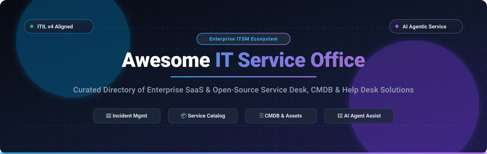

# 🏢 Awesome IT Service Office (ITSM)

     

**A definitive, community-curated directory of top-tier Enterprise SaaS platforms and Open-Source software for IT Service Management (ITSM), ITIL v4 processes, Help Desks, Configuration Management Databases (CMDB), and Self-Service Portals.**

*Tracked and updated regularly • Last updated: October 2026*

---

## 📑 Table of Contents

- [🌐 Sector Overview & Market Dynamics](#-sector-overview--market-dynamics)
- [☁️ Enterprise SaaS & Hosted Platforms](#-enterprise-saas--hosted-platforms)
- [🔓 Open-Source GitHub Projects](#-open-source-github-projects)
- [⚖️ Architecture & Framework Selection Guide](#-architecture--framework-selection-guide)
- [🤝 How to Contribute](#-how-to-contribute)
- [💖 Support & Sponsorship](#-support--sponsorship)
- [⭐ Star History](#-star-history)
- [📜 Disclaimer & License](#-disclaimer--license)

---

## 🌐 Sector Overview & Market Dynamics

The global **IT Service Management (ITSM) and Service Desk market** is currently valued at approximately **$10.5 Billion** and is projected to reach over **$22.1 Billion to $25.0 Billion by 2030**, exhibiting a robust Compound Annual Growth Rate (**CAGR of ~16.2%**). This accelerating demand is propelled by hybrid workplace models, ITIL v4 framework adoption, automated incident remediation, and rapid integration of generative AI / autonomous service desk agents.

In terms of structure, the sector is **moderately concentrated at the enterprise summit**—where established tech titans like *ServiceNow*, *Atlassian*, and *BMC Software* command the majority of large enterprise global contracts—coexisting with a **vibrant, highly competitive fragmented tier** of agile mid-market challengers (*Freshworks*, *ManageEngine*, *HaloITSM*, *SysAid*) and community-supported open-source frameworks. These mid-market and open-source platforms compete aggressively through transparent per-seat pricing, agentic AI copilots, fast self-service deployment, and freedom from proprietary lock-in.

---

## ☁️ Enterprise SaaS & Hosted Platforms

Below is the curated selection of market-leading SaaS IT Service Office suites, sorted in descending order by **Company Size (Market Capitalization / Valuation / Revenue)**.

| 🏢 Platform / Vendor | 📊 Company Size (Valuation / Revenue) | 🏷️ Starting Tier Price | 🎁 Free Tier / Free Trial Limits | 🚀 Core Capabilities & ITIL Highlights |
| :--- | :--- | :--- | :--- | :--- |
| **[ServiceNow IT Service Office](https://www.servicenow.com/)** | **~$185B Market Cap** (NYSE: NOW) • ~$10.99B Annual Revenue | **~$70 – $100 / fulfiller / month** *(Foundation tier list; typical $10,000/yr minimum commitment)* | **Free Personal Developer Instance (PDI)** with full admin/developer access on `developer.servicenow.com` (indefinite if active every 10 days); or **15-day guided enterprise sandbox** | Enterprise ITSM benchmark on Now Platform. Bundles Now Assist GenAI, ITIL change/incident/problem workflows, CMDB baselines, and cross-department process mining. |
| **[Jira Service Management](https://www.atlassian.com/software/jira/service-management)** | **~$60B Market Cap** (NASDAQ: TEAM) • ~$4.36B Annual Revenue | **$17.65 / agent / month** *(billed annually)* or **$20.00 / agent / month** *(billed monthly, Standard tier)* | **Free Forever plan** for up to **3 agents**, 2 GB storage, and unlimited customer portal requestors; **7-day free trial** on Standard & Premium tiers up to 10 agents | Atlassian Intelligence (Rovo), native Jira software and DevOps integration, IT Asset & Configuration Management, on-call alert scheduling, and post-incident review automation. |
| **[ManageEngine ServiceDesk Plus](https://www.manageengine.com/products/service-desk/)** | **~$15B Valuation** (Zoho Corp Private) • ~$1.4B Annual Revenue | **$10 – $13 / technician / month** *(billed annually, Standard Cloud; Professional at $21/mo, Enterprise at $50/mo)* | **Free Forever Edition** for up to **5 technicians** with unlimited requesters (Standard Edition helpdesk & knowledge base); **30-day fully functional enterprise trial** | ITIL-aligned service desk with Zia AI agents, Model Context Protocol (MCP) support, CMDB baselines, peek views, and customizable technician workspaces. |
| **[BMC Helix ITSM](https://www.bmc.com/)** | **~$9.5B Valuation** (Private Equity - KKR/Elliott) • ~$2.3B Annual Revenue | **~$110 – $140 / agent / month** *(post-negotiation baseline; list price ~$180 – $320/agent/mo)* | **30-day guided cloud evaluation sandbox** and proof-of-concept (PoC) environment provisioned via enterprise sales validation | Autonomous ITIL-compliant service desk, Ticket Resolver, Problem Solver recurring incident detection, Post Incident Reviews (PIR), and HelixGPT CMDB insights. |
| **[Ivanti Neurons for ITSM](https://www.ivanti.com/)** | **~$4.2B Valuation** (Private - Clearlake/TA) • ~$1.5B Annual Revenue | **~$85 – $115 / named analyst / month** *(billed annually as ~$1,000 – $1,400/analyst/year)* | **14-day vendor-hosted guided test-drive sandbox** provisioned with pre-loaded ITIL demo tickets and asset datasets | Hyper-automation bots, self-healing endpoint discovery, ITIL service catalog, IT Asset Management (ITAM), and multi-department service management. |
| **[Cherwell Service Management](https://www.cherwell.com/)** | **~$4.2B Parent Valuation** (Ivanti) • ~$1.5B Parent Revenue | **~$50 / named user / month** or **~$80 / concurrent user / month** *(billed annually)* | **14-day sales-hosted virtual lab / PoC environment** upon enterprise request with pre-configured workflows | Codeless business logic engine, One-Step automation routines, ITIL change management, and configurable browser-based service desk portals. |
| **[Freshservice](https://www.freshworks.com/freshservice/)** | **~$4.0B Market Cap** (NASDAQ: FRSH) • ~$720M Annual Revenue | **$19.00 / agent / month** *(billed annually)* or **$29.00 / agent / month** *(billed monthly, Starter plan)* | **14-day free trial** with full unrestricted access to Pro Tier features, unlimited agents, and Freddy AI copilot testing; no credit card required | Freddy AI ticket deflection and virtual agent assistance, ITIL service catalog, SLA management, release management, project portfolio management, and 1,400+ marketplace apps. |
| **[SolarWinds Service Desk](https://www.solarwinds.com/service-desk)** | **~$2.3B Market Cap** (NYSE: SWI) • ~$785M Annual Revenue | **$39.00 / technician / month** *(billed annually, Essentials plan; Advanced at $99/mo, Premier at $124/mo)* | **30-day fully functional free trial** with full Premier-level capabilities and unlimited agents; no credit card required | Incident and request management, visual CMDB dependency mapping, AI-guided resolution recommendations, and native SolarWinds infrastructure monitoring feeds. |
| **[TOPdesk](https://www.topdesk.com/)** | **~$700M Valuation** (Private) • ~$110M Annual Revenue (€100M+ ARR) | **$51 – $55 / technician / month** *(billed annually, Essential plan; Engaged at ~$72/mo, Excellent at ~$101/mo)* | **30-day fully functional free trial** with complete operator and customer self-service portal access and unlimited asset testing; no credit card required | AI-assisted ticket triage and category prediction, modular service management, unlimited asset storage, and unified multi-department shared service center. |
| **[SysAid](https://www.sysaid.com/)** | **~$400M Valuation** (Private - Crestview) • ~$60M Annual Revenue | **$89.00 / agent / month** *(billed annually, Professional plan; base 5-admin subscription ~$101/mo)* | **30-day free trial** with full AI Copilot access, 100+ pre-built AI agents, and up to 5 admin seats; no credit card required | Agentic AI deeply integrated into ITIL incident resolution, Splashtop remote desktop support integration, Qlik BI reporting, and license utilization insights. |
| **[HaloITSM](https://www.haloitsm.com/)** | **~$300M Valuation** (Private) • ~$45M Annual Revenue | **$99.00 / agent / month** *(billed annually for small teams; scales down to $65.00/agent/mo for 50+ seats)* | **30-day fully functional free trial** with complete access to all modules, ITIL processes, and Halo AI; no credit card required | Single transparent tier with all ITIL processes unlocked, approval matrixes, custom SLA tracking, asset lifecycle management, and multi-tenant MSP support. |

---

## 🔓 Open-Source GitHub Projects

Explore the top self-hosted, community-driven IT Service Management, ITIL Service Desk, and Asset Management systems. Repositories are sorted in descending order by **GitHub Stars_Count**, with direct links to each project's stargazers community.

1. **[UVdesk Community Skeleton](https://github.com/uvdesk/community-skeleton)**   
   *Technology: PHP / Symfony / MySQL*  
   Enterprise-grade open-source helpdesk and customer ticketing system with multi-channel support (email, web forms, API), automated workflow engines, custom fields, and extensive third-party plugin modularity.

2. **[Snipe-IT](https://github.com/grokability/snipe-it)**   
   *Technology: PHP / Laravel / MySQL*  
   The gold standard open-source IT asset management (ITAM) and CMDB system essential for IT service offices. Enables tracking of hardware inventory, software licenses, digital accessories, depreciation schedules, and user check-ins/outs with QR barcode scanning and a RESTful API.

3. **[GLPI](https://github.com/glpi-project/glpi)**   
   *Technology: PHP / MySQL / JavaScript*  
   Full-spectrum open-source ITIL Service Desk and asset management suite. Features a comprehensive CMDB, incident/problem/change tracking, SLA escalations, financial contract tracking, data center infrastructure management (DCIM), and a modular plugin ecosystem.

4. **[Zammad](https://github.com/zammad/zammad)**   
   *Technology: Ruby on Rails / PostgreSQL / Elasticsearch*  
   High-performance, modern open-source help desk and customer service system featuring omnichannel ticket aggregation (email, phone, chat, social media), real-time ticket updates, full-text search via Elasticsearch, REST APIs, and granular role permissions.

5. **[FreeScout](https://github.com/freescout-help-desk/freescout)**   
   *Technology: PHP / Laravel / MySQL*  
   Lightweight, self-hosted omnichannel helpdesk and shared mailbox platform built as an open-source alternative to Help Scout and Zendesk, featuring collision detection, satisfaction ratings, LDAP/SAML integration, and community AI integration modules.

6. **[osTicket](https://github.com/osTicket/osTicket)**   
   *Technology: PHP / MySQL*  
   Battle-tested open-source support ticketing platform with custom forms and fields, rich HTML auto-responders, ticket routing filters, SLA management, and an integrated customer self-service web portal.

7. **[Frappe Helpdesk](https://github.com/frappe/helpdesk)**   
   *Technology: Python / Frappe / Vue.js*  
   Sleek, reactive customer support and service desk software built on the Frappe framework with real-time assignment, automated SLA escalation policies, knowledge base authoring, and native ERPNext integration.

8. **[Peppermint](https://github.com/Peppermint-Lab/peppermint)**   
   *Technology: Node.js / TypeScript / React / Prisma*  
   Modern, lightweight open-source issue management and IT service ticketing application designed as an agile alternative to Jira Service Management and Zendesk, featuring markdown support, real-time collaboration, and fast containerized deployment.

9. **[Helpy](https://github.com/helpyio/helpy)**   
   *Technology: Ruby on Rails / PostgreSQL*  
   Modern, mobile-first open-source help desk and customer engagement platform offering multi-channel ticketing, multi-language knowledge base documentation, and community self-service forums.

10. **[Trudesk](https://github.com/polonel/trudesk)**   
    *Technology: Node.js / MongoDB / React*  
    Fast, real-time open-source help desk and service desk software built with WebSockets for instant ticket status synchronization, SLA management, custom ticket types, and visual analytics reporting.

11. **[iTop](https://github.com/Combodo/iTop)**   
    *Technology: PHP / MySQL / Web Services*  
    Fully ITIL-compliant, web-based IT service management platform featuring an adaptable CMDB, incident and service request management, change management, SLA definitions, and graphical infrastructure impact analysis.

12. **[Request Tracker (RT)](https://github.com/bestpractical/rt)**   
    *Technology: Perl / PostgreSQL / MySQL*  
    Enterprise-grade open-source issue tracking and workflow management system powering critical NOCs, universities, and government IT service desks worldwide with industrial email parsing and PGP/GPG encryption.

13. **[Znuny](https://github.com/znuny/Znuny)**   
    *Technology: Perl / JavaScript / PostgreSQL / MariaDB*  
    Long-term enterprise fork of the renowned OTRS community edition; provides rock-solid web-based ticketing, customer service workflows, ITIL processes, and high customizability for IT service delivery.

14. **[bk-itsm (BlueKing ITSM)](https://github.com/TencentBlueKing/bk-itsm)**   
    *Technology: Python / Django / Vue*  
    Enterprise IT service process management framework from Tencent BlueKing, featuring visual workflow modeling, automated execution pipelines, and tight integration with CMDB and cloud orchestration systems.

15. **[FreeITSM](https://github.com/edmozley/freeitsm)**   
    *Technology: Go / Svelte / SQLite*  
    Lightweight, data-ownership focused ITSM tool featuring keyboard-driven command palette (⌘K/Ctrl-K), multi-technician task involvement, Microsoft 365 calendar sync, and optional BYO AI ticket summaries.

16. **[NeatLogic ITOM](https://github.com/neatlogic/neatlogic-itom-all)**   
    *Technology: Java / Spring Boot / Vue*  
    Progressive open-source IT Operations Management (ITOM) platform converging ITSM workflows, automated CMDB discovery, automated inspection, continuous deployment, and knowledge management.

---

## ⚖️ Architecture & Framework Selection Guide

| Dimension | ☁️ Commercial SaaS Platforms | 🔓 Self-Hosted Open-Source Solutions |
| :--- | :--- | :--- |
| **Target Deployment** | Cloud-native, zero-infrastructure overhead, automated security updates | Air-gapped on-premises, private cloud, sovereign data ownership |
| **Licensing Economics** | Predictable per-agent / per-technician monthly or annual subscription | Permissive open-source licenses (GPL, AGPL, MIT, Apache); zero per-seat fees |
| **ITIL Maturity** | Out-of-the-box ITIL v4 processes, certified audit compliance, automated workflows | Highly customizable; requires initial workflow architecture and CMDB modeling |
| **AI Capabilities** | Native generative copilots (Now Assist, Freddy AI, Zia, Atlassian Rovo) | Self-hosted LLM endpoints via Ollama, local models, or bring-your-own API keys |
| **Best Suited For** | Fast-scaling enterprises, distributed teams needing 24/7 SLAs & turnkey apps | Privacy-sensitive organizations, universities, MSPs building tailored platforms |

---

## 🤝 How to Contribute

Contributions are warmly welcomed! Help keep this repository the premier guide for IT service operations:

1. 🍴 **Fork the repository** on GitHub.
2. 🌿 **Create a new branch** (`git checkout -b feature/add-new-service-desk`).
3. ✍️ **Add or update entries** in `README.md` following the existing format:
   - Include: exact product name, official URL, pricing structure, free tier/trial limits, and company size/Stars_Badge.
   - Maintain objective, factual descriptions without marketing jargon.
4. 🚀 **Submit a Pull Request** with a concise summary of your addition.

---

## 💖 Support & Sponsorship

If this curated directory has helped you evaluate, architect, or streamline your IT Service Office ecosystem, please consider supporting the project:

- ⭐ **Star this repository** to help fellow engineers, SysAdmins, and IT leaders discover it!
- 🍴 **Fork and share** with your DevOps and IT operations community!
- 📢 **Spread the word** on LinkedIn, Reddit, and Discord!
- ☕ **Support the maintainer**: Continuous curation, research, and maintenance are powered by the community. You can buy a coffee or sponsor via the [GitHub Sponsor Dashboard](https://github.com/sponsors/ishandutta2007).

---

## ⭐ Star History

---

## 📜 Disclaimer & License

- This repository is a community-curated educational directory and does not constitute an official commercial endorsement.
- All product names, logos, and brands are property of their respective owners.
- Open-source solutions should be verified for individual license terms (AGPL-3.0, GPL-3.0, Apache-2.0, or MIT) prior to commercial deployment.
- Distributed under the [MIT License](LICENSE). Built with ❤️ for IT Service Managers, Help Desk Administrators, and IT Operations Engineers.
